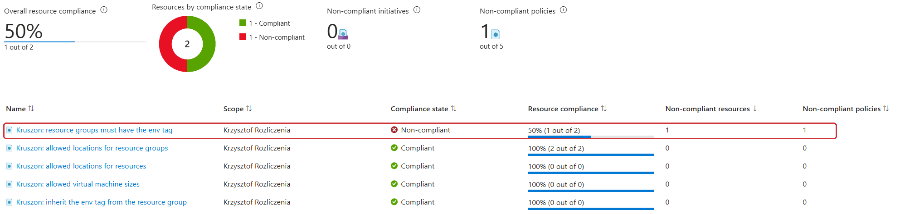
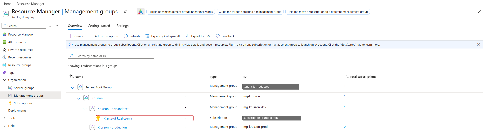
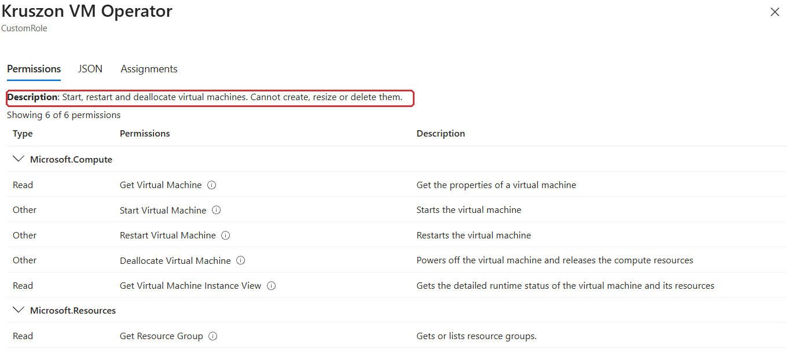
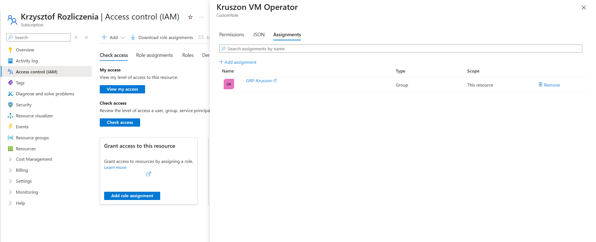

# governance — guardrails for the subscription

**Business need:** nobody should be able to deploy outside Europe, start an expensive VM by mistake or leave untagged resources; the help desk must restart VMs without being able to delete them; spending must raise an alert before it hurts.

**Solution:** one subscription-scope Bicep deployment creates five policy assignments, a custom role and a monthly budget. A shell script builds the management-group hierarchy the subscription lives in.

| File | What it does | Exam skills |
| --- | --- | --- |
| `main.bicep` | policy assignments (allowed locations, allowed VM sizes, tag inheritance), custom role, budget | Azure Policy, custom roles, costs |
| `management-groups.sh` | `mg-kruszon` hierarchy, subscription moved under `mg-kruszon-dev` | management groups |
| `roles/vm-operator.json` | the same custom role in the JSON format the exam shows | interpret role definitions |

## Deploy

The budget alert recipient is not stored in the repository, so set it first:

```powershell
$env:KRUSZON_BUDGET_EMAIL = "you@example.com"
az deployment sub what-if --location northeurope --parameters governance/main.bicepparam
az deployment sub create --name governance-01 --location northeurope --parameters governance/main.bicepparam
```

`management-groups.sh` is a Bash script, so run it from Azure Cloud Shell:

```bash
./governance/management-groups.sh <subscription-id>
```

CLI alternative for the custom role (set `deployCustomRole = false` in `main.bicepparam` first):

```bash
az role definition create --role-definition @governance/roles/vm-operator.json   # put your subscription ID in AssignableScopes
```

## Verify

| Exam skill | What I checked | Evidence |
| --- | --- | --- |
| Azure Policy, deny effect | a resource group outside Europe is rejected | [command output](#a-deny-policy-stops-the-request) |
| Azure Policy, compliance | an untagged resource group is reported as non-compliant | [screenshot](#compliance-after-an-on-demand-scan) |
| Management groups | the subscription sits under `mg-kruszon-dev` | [screenshot](#management-group-hierarchy) |
| Custom roles | the role starts and stops VMs but cannot create or delete them | [screenshot](#the-custom-role) |
| Role assignment | the role is held by a group, not by a person | [screenshot](#the-role-assignment) |
| Budgets | 25 USD a month, alerts at 50%, 80% and a 100% forecast | `budget-kruszon-monthly` in `main.bicep` |

### A deny policy stops the request

Creating a resource group in West US fails before anything is provisioned:

```
(RequestDisallowedByPolicy) Resource 'rg-kruszon-policytest' was disallowed by policy.
```

The useful part of the error is the evaluation detail, which names the expression that failed:

```json
{ "result": "True", "expression": "location", "expressionValue": "westus",
  "targetValue": ["northeurope", "westeurope"], "operator": "NotIn" }
```

Both expressions of the rule returned `True`, so the effect `Deny` applied. The same resource group was created without complaint in North Europe.

### Compliance after an on-demand scan

Two test resource groups, one tagged `env=dev` and one without a tag, were created in North Europe and evaluated with `az policy state trigger-scan`.



The location rules report `2 out of 2` because both groups are in an allowed region. The three remaining assignments show `0 out of 0`: there are no virtual machines or other resources in scope yet, so nothing was evaluated. A green `0 out of 0` is not the same as proof that everything is in order.

### Management group hierarchy



The policies are assigned at subscription scope. Assigning them to `mg-kruszon` instead would make every future subscription inherit them, which is how this would be done in a real tenant.

### The custom role



Six actions, no write and no delete. The help desk can bring a machine back up, and cannot resize or remove it.

### The role assignment



## Access matrix

Roles are assigned to groups, never to individual accounts.

| Who | Role | Scope | Status |
| --- | --- | --- | --- |
| GRP-Kruszon-IT | Kruszon VM Operator | subscription | assigned |
| GRP-Kruszon-IT | Contributor | `rg-kruszon-network-dev` | planned, week T4 |
| Accounting firm (guest) | Reader | `rg-kruszon-data-dev` | planned, week T6 |

## Decisions and lessons

- **The tag rule runs in `DoNotEnforce` mode.** Enforced, it would reject the resource groups that the official AZ-104 labs create on the fly. Reporting mode still produces compliance data, which is what the module needs.
- **A `modify` effect needs an identity.** `kruszon-inherit-env-tag` is the only assignment with a system-assigned identity and a location, because it changes resources instead of only judging them. The deployment therefore also creates a role assignment granting that identity Contributor.
- **The built-in "Allowed virtual machine size SKUs" policy checks virtual machines only.** Scale sets need a custom definition.
- **A budget alerts; it never stops or deletes anything.** Spending control is a notification, not a brake.
- **Compliance reporting is a separate, slower path than enforcement.** `Deny` works the moment the assignment exists, but the compliance view stays empty until `Microsoft.PolicyInsights` is registered and a scan has run ([troubleshooting](../docs/troubleshooting.md#az-policy-state-fails-with-subscriptionnotregistered)).