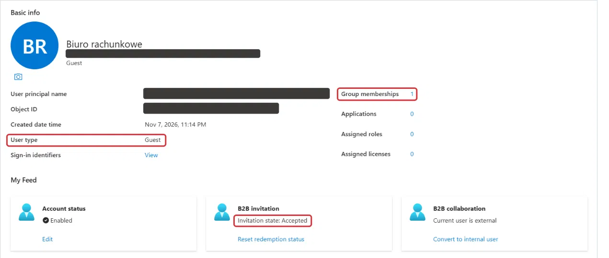

# identity — Microsoft Entra ID

**Business need:** Kruszon's 25 employees work in six departments; they need accounts on day one, and access must follow their department automatically.

**Solution:** `New-KruszonIdentity.ps1` reads `employees.csv`, creates users with Microsoft Graph PowerShell and one security group per department (assigned or dynamic membership).

## Run

```powershell
Install-Module Microsoft.Graph -Scope CurrentUser
./identity/New-KruszonIdentity.ps1 -Domain <tenant>.onmicrosoft.com -WhatIf          # preview
./identity/New-KruszonIdentity.ps1 -Domain <tenant>.onmicrosoft.com -DynamicGroups   # needs Entra ID P1/P2
```

`-WhatIf` still signs in to Microsoft Graph, because the script checks which users and groups already exist.

## Configured in the portal

| Exam skill | What I configured | Evidence |
| --- | --- | --- |
| Manage licenses | group-based licensing for GRP-Kruszon-IT | planned |
| External users | B2B guest invited for the accounting firm | [screenshot](#b2b-guest-for-the-accounting-firm) |
| SSPR | self-service password reset for GRP-Kruszon-IT (pilot) | planned |
| User and group properties | dynamic rule `user.department -eq "Sprzedaż"` | planned |

### B2B guest for the accounting firm

The accounting firm's contact is a B2B guest: the invitation is accepted, the user type is Guest, and the account belongs to one group. The user principal name and object ID are hidden.



## Decisions and lessons

- **Microsoft Graph with a personal account:** `Connect-MgGraph` needs `-TenantId`. Without it, a personal Microsoft account signs in as a consumer account, and creating users fails with 403 or 405 ([troubleshooting](../docs/troubleshooting.md#microsoft-graph-returns-403405-when-creating-users)).
- **Separate admin account:** group-based licensing is managed in the Microsoft 365 admin center, which doesn't accept personal Microsoft accounts, so I created a cloud-only admin account in the tenant.
- **Check a guest's email before you invite:** my first invitation was sent to an address with a typo. Correcting the email kept the same account and its group membership, but the user principal name still contains the typo.